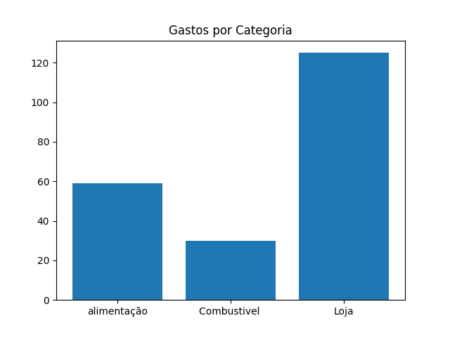

# Smart Budget

Versão em Python do meu [controle de gastos](https://github.com/felippegasques-bot/controle-gastos): um servidor Flask que guarda os gastos num banco SQLite e gera um gráfico por categoria com Matplotlib.

O projeto começou como um script de terminal e foi crescendo até virar uma aplicação web publicada no Render.



## O que faz

- Cadastra gastos com descrição, valor e categoria (a data entra automaticamente)
- Lista todos os gastos numa tabela
- Gera um gráfico de barras com o total por categoria

## Como o código está organizado

| Arquivo | Responsabilidade |
| --- | --- |
| `app.py` | Conexão com o SQLite, criação da tabela, inserir e listar gastos |
| `analise.py` | Soma dos gastos por categoria |
| `main.py` | Ponto de entrada da versão de terminal |
| `web.py` | Rotas do Flask: `/` (lista), `/add` (novo gasto) e `/grafico` |
| `templates/` | Páginas HTML com Jinja |

## Como rodar

```bash
pip install -r requirements.txt
python web.py
```

Depois abra http://localhost:5000 no navegador.

## Tecnologias

Python, Flask, SQLite, Matplotlib e Gunicorn (para publicar no Render).

## Próximos passos

- Editar e remover gastos
- Filtrar por mês
- Login, para cada pessoa ver só os próprios gastos
